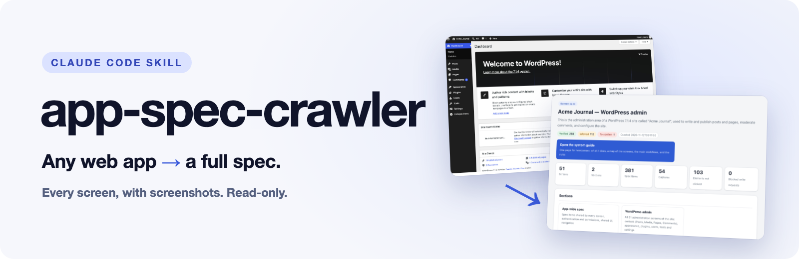

<p align="center">
  <picture>
    <source media="(prefers-color-scheme: dark)" srcset="docs/readme/banner-dark.png" />
    
  </picture>
</p>

<p align="center">
  <strong>Point Claude Code at any web app you're logged into. Get the spec — every screen, with screenshots. Read-only.</strong>
</p>

<p align="center">
  <a href="https://github.com/akkijp/app-spec-crawler-skill/stargazers"><picture><source media="(max-width: 767px)" srcset="https://img.shields.io/github/stars/akkijp/app-spec-crawler-skill?style=flat-square&labelColor=0F1320&logo=github&logoColor=white&color=4F6BFF" /></picture></a>
  <a href="LICENSE"><picture><source media="(max-width: 767px)" srcset="https://img.shields.io/badge/license-MIT-4F6BFF?style=flat-square&labelColor=0F1320" /></picture></a>
  <a href="https://docs.anthropic.com/en/docs/claude-code"><picture><source media="(max-width: 767px)" srcset="https://img.shields.io/badge/Claude_Code-skill-D97757?style=flat-square&labelColor=0F1320" /></picture></a>
  <br />
  <a href="#read-only"><picture><source media="(max-width: 767px)" srcset="https://img.shields.io/badge/crawl-read--only-12A15F?style=flat-square&labelColor=0F1320" /></picture></a>
  <a href="docs/usage.md"><picture><source media="(max-width: 767px)" srcset="https://img.shields.io/badge/docs-en_·_ja_·_zh_·_es_·_ko-5B6B9A?style=flat-square&labelColor=0F1320" /></picture></a>
</p>

<p align="center"><b>English</b> · <a href="README.ja.md">日本語</a></p>

https://github.com/user-attachments/assets/0f28552f-e581-4f41-b838-a610962fed5f

<p align="center"><sub>Recorded on an earlier run of the WordPress sample (51 screens, 381 spec items). With sound.</sub></p>

I inherited an admin panel with no documentation. This [Claude Code](https://docs.anthropic.com/en/docs/claude-code) skill walks every screen in your own logged-in Chrome, takes a full-page screenshot of each, and has Claude write the documents you wish had come with the system.

##  Use it for

- Internal tools nobody documented
- Taking stock of a SaaS before you migrate off it
- Onboarding: "what does this system even do?"

##  What you get

- **System guide** — one page for newcomers: what the system does, a map of the screens, the main workflows, the rules
- **Screen spec** — every screen, with numbered spec items. Each item says whether it was **Verified** on screen, **Inferred**, or still **To confirm**, and links to the screenshot it came from

Both are plain HTML. Open them in a browser, zip them, hand them over.

The documents are written in the language you talk to Claude in. Five languages are supported: English, Japanese, Simplified Chinese, Spanish and Korean. In any other language the frame is in English. The Chinese, Spanish and Korean wording is machine-translated; corrections are welcome.

##  Read-only

The crawler opens pages by URL and looks. It has no code that types into a field or submits a form.

- It never clicks Save, Delete, Approve, Send or anything like them. The only clicks are on in-page tabs.
- It does not open URLs that contain words such as `logout`, `delete`, `approve` or `export`.
- It does not open links that carry an anti-forgery token (`_wpnonce`, `csrf_token`, `authenticity_token`…) or an action parameter that is not known to be read-only. Some apps change data on a plain link — WordPress "Trash" and "Activate" are examples — and this is how such links are recognised.
- Every URL it decided not to open is listed, with the reason, in `safety_report.json`.

**What it cannot know:** an app can change something merely because a page was opened. WordPress, for example, creates a draft the moment "Add Post" loads. If you know of such a screen, exclude it with `--exclude`. On a system you cannot afford to disturb, ask the people who built it first.

Details: [how the safety rules work](docs/how-it-works.md), [the full policy](references/safety-policy.md).

##  Install

Paste this into Claude Code. Claude installs the skill and checks that it can run.

```text
Install the Claude Code skill app-spec-crawler.

1. git clone https://github.com/akkijp/app-spec-crawler-skill.git ~/.claude/skills/app-spec-crawler
   (if it already exists, do not overwrite it — ask me)
2. mkdir -p ~/.local/bin && ln -sf ~/.claude/skills/app-spec-crawler/bin/app-spec-crawler ~/.local/bin/app-spec-crawler
3. Run app-spec-crawler doctor and show me the result as it is.
4. If anything is NG, explain why and how to fix it. Ask me before installing or changing anything.
```

Requirements: macOS, Google Chrome, [browser-use](https://github.com/browser-use/browser-use), Claude Code. See [docs/install.md](docs/install.md).

##  Use

1. Log in to the target app in Chrome
2. Ask Claude Code

```text
Crawl https://app.example.com/admin/ and write the spec
```

Claude crawls the screens, describes each one, builds the screen spec, writes the system guide, and checks how the result looks. It then tells you where the documents are.

##  How long, how much

Measured on a local WordPress admin (fictional content):

- 47 screens crawled in 8 min 20 s
- About 20 minutes from the prompt to the finished documents for roughly 50 screens
- Writing the system guide calls `claude -p` with a budget cap of $8 by default (`--budget`). Describing the screens uses your Claude Code session.

Your numbers will differ with the size of the app and how fast its pages render.

##  Limits

- macOS only for now.
- Screens that need a click to appear (modals, wizards, anything behind a button) are not captured, because the crawler does not click.
- First-run dialogs that an app shows over a screen stay in the screenshot; closing them would need a click.
- Screens that render late are waited for up to 8 seconds (`--settle-max`). Some still come out half-drawn.
- What a button does is always marked **Inferred**. Nothing was pressed to find out.
- The spec describes what one account can see. Other roles need another crawl.

##  Please

Run it on systems you own or are allowed to document. A spec of someone else's product, with their screens in it, is theirs — check before you publish one.

There is no token, coin or paid version of this project. This repository is the only official source.

##  More

- [Installation and requirements](docs/install.md)
- [Usage](docs/usage.md) — commands, options, what to do on errors
- [How it works](docs/how-it-works.md) — the pipeline, the documents, the safety rules

##  Contact

Found a bug or a screen it gets wrong? Open an issue. For anything that does not fit an issue, such as collaboration or press, start from the author's site.

<p>
  <a href="https://github.com/akkijp/app-spec-crawler-skill/issues/new"></a>
  <a href="https://akki.jp"></a>
</p>

##  License

[MIT © akki](LICENSE)
